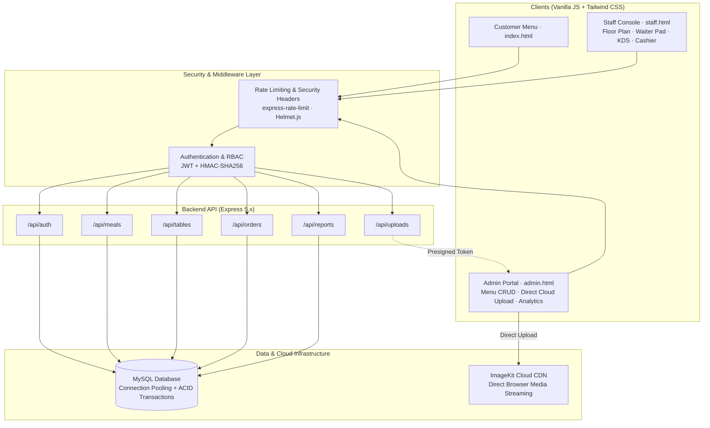
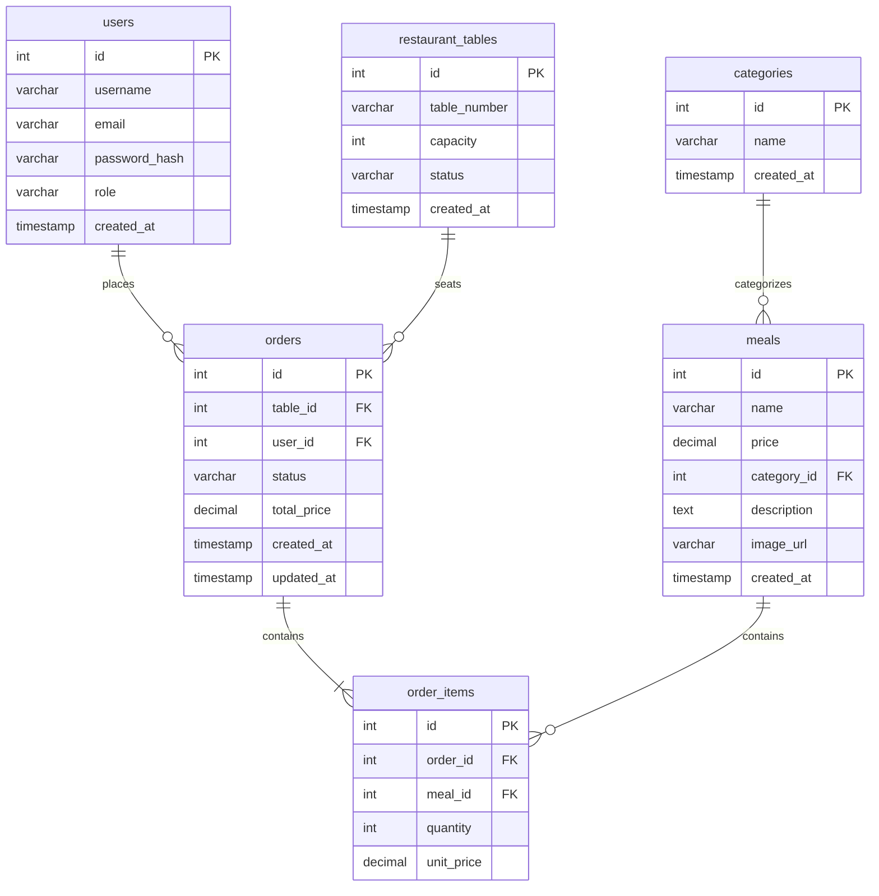

# 🌿 Fig & Olive — Mediterranean Kitchen & Restaurant Management System

> A production-grade, full-stack Restaurant Management System built with **Node.js (Express 5)**, **MySQL**, and **Modern Vanilla JavaScript + Tailwind CSS**. Features multi-station real-time operations, ACID-compliant transactions, Role-Based Access Control (RBAC), and direct-to-cloud media streaming via ImageKit.

---

## 🏛️ System Architecture



---

## 💾 Database Schema & ERD

The relational database architecture is strictly normalized with foreign key integrity, snapshot pricing, and transactional state synchronization:



### Key Relational Design Principles:
* **`ON DELETE CASCADE`** on `order_items.order_id`: Order line items exist only within the context of an order.
* **`ON DELETE RESTRICT`** on `order_items.meal_id`: Prevents deleting menu items that exist on historical paid receipts, preserving accounting and tax integrity.
* **Price Snapshotting**: `order_items` stores `unit_price` at the moment of ordering, so future menu price changes never alter historical customer receipts.

---

## ✨ Core Features & Multi-Station Workflow

### 1. 🍽️ Customer Menu Experience (`/index.html`)
* Dynamic catalog rendering directly from MySQL database.
* Real-time category filtering (Pastas, Pizzas, Mediterranean Grills, Salads, Dolci) and instant client-side search.
* Interactive Dish Modal with portion counters and chef instructions.
* Mediterranean aesthetic designed with Tailwind CSS typography, limestone palettes, and micro-interactions.

### 2. 📱 Staff Operations Console (`/staff.html`)
A unified station dashboard serving the 3 primary restaurant roles:
* **Station 1: Table Floor Plan**: Real-time table status grid with emerald (Available) and amber (Occupied) rings, capacity badges, and active order inspection drawer.
* **Station 2: Waiter Order Pad**: Modal menu item selector with live item tallying. Submits multi-item orders in **ACID transactions** (`connection.beginTransaction()`, `commit()`, `rollback()`) that auto-occupies the table.
* **Station 3: Kitchen Display System (KDS)**: Kanban ticket board (`Pending` ➔ `Preparing` ➔ `Served`) with action bump buttons for chefs.
* **Station 4: Cashier Billing**: One-click settlement (`paid`) that automatically recalculates sales and frees the dining table back to available in MySQL.

### 3. 📊 Executive Admin Console (`/admin.html`)
* **Sales Analytics**: Real-time KPI summaries (Settled Revenue, Paid Orders, Top Selling Dish) with interval filtering (`24 Hours`, `Past Week`, `Past Month`, `All Time`).
* **Catalog Management**: Polymorphic modal for creating and updating menu items with instant validation.
* **Direct-to-Cloud Uploads**: Uploads food photos straight to ImageKit CDN using temporary presigned HMAC signatures, bypassing the Node.js event loop and preventing server memory bloat.

---

## 🔒 Security & Engineering Best Practices

* **Cryptographic Hashing**: Passwords salted with `bcryptjs` (Cost factor 10) to mitigate dictionary and precomputed rainbow table attacks.
* **SQL Injection Prevention**: All MySQL queries utilize prepared statements with parameterized inputs (`?`).
* **Stateless Authentication**: Signed JWT tokens (`HMAC-SHA256`) containing minimal claims (`{ id, role }`) with 24-hour expiration.
* **Role-Based Access Control (RBAC)**: Higher-order middleware factories (`authorize('admin', 'waiter', ...)`).
* **Brute-Force & DoS Defense**: IP-based rate limiting via `express-rate-limit` protecting `/api/auth/login` (HTTP 429 Too Many Requests).
* **Information Disclosure Defense**: Centralized error middleware masking internal 500 error stack traces when running in production.

---

## 🛠️ Tech Stack

| Domain | Technology | Purpose |
| :--- | :--- | :--- |
| **Runtime** | Node.js (v18+) | Non-blocking asynchronous I/O runtime |
| **Framework** | Express 5.x | RESTful API routing, controller architecture, middleware |
| **Database** | MySQL 8.x | ACID relational database, foreign key constraints, connection pooling |
| **Database Driver** | `mysql2/promise` | Async/await Promise-based queries with prepared statements |
| **Authentication** | `jsonwebtoken` & `bcryptjs` | Stateless JWT Bearer tokens and adaptive one-way password hashing |
| **Cloud Media** | ImageKit.io CDN | Direct browser-to-cloud binary streaming via presigned tokens |
| **Frontend** | Vanilla JS (ES Modules) | Lightweight, dependency-free DOM manipulation and async fetch |
| **Styling** | Tailwind CSS v4 | Curated design tokens, typography, and responsive layouts |

---

## 🚀 Quickstart & Local Installation

### Prerequisites
* [Node.js](https://nodejs.org/) (v18 or higher)
* [MySQL](https://www.mysql.com/) (v8 or higher)

### 1. Clone the repository
```bash
git clone https://github.com/your-username/fig-and-olive.git
cd fig-and-olive
```

### 2. Install dependencies
```bash
npm install
```

### 3. Configure Environment Variables
Copy `.env.example` to create your local `.env`:
```bash
cp .env.example .env
```
Fill in your local MySQL credentials and ImageKit keys:
```env
PORT=8000
NODE_ENV=development
DB_HOST=localhost
DB_USER=root
DB_PASSWORD=your_password
DB_NAME=fig_and_olive
JWT_SECRET=your_super_secret_jwt_key
IMAGEKIT_PUBLIC_KEY=your_imagekit_public_key
IMAGEKIT_PRIVATE_KEY=your_imagekit_private_key
IMAGEKIT_URL_ENDPOINT=https://ik.imagekit.io/your_id
```

### 4. Initialize Database & Seed Demo Data
You can initialize the database tables and seed sample dishes, categories, tables, and staff accounts in a single automated step:
```bash
npm run seed
```
*(Alternatively, manually execute `mysql -u root -p < schema.sql`)*

### 5. Start Development Server
```bash
npm run dev
```
Open [http://localhost:8000](http://localhost:8000) in your browser.

---

## 🔑 Demo Test Accounts

The seeder automatically provisions test credentials with pre-configured roles:

| Role | Email | Password | Access / Primary Dashboard |
| :--- | :--- | :--- | :--- |
| **Admin** | `admin@restaurant.com` | `admin123` | Full access · `/admin.html` (Catalog CRUD, Analytics, Uploads) |
| **Waiter** | `waiter@restaurant.com` | `waiter123` | Staff access · `/staff.html` (Floor Plan, Waiter Order Pad) |
| **Cashier** | `cashier@restaurant.com` | `cashier123` | Staff access · `/staff.html` (Kitchen KDS, Cashier Settlement) |

> 💡 **Quick Login:** On the login page (`/login.html`), click any of the **Quick Demo Fill** buttons to test each role instantly.

---

## ☁️ Production Deployment

This project is 100% production-ready for deployment on **Render**, **Railway**, or any Node.js container host:

1. **Environment Variables**:
   - `PORT`: Set dynamically by host (defaults to `8000`)
   - `NODE_ENV`: Set to `production`
   - `DATABASE_URL`: Cloud MySQL connection URI (or separate `DB_HOST`, `DB_USER`, `DB_PASSWORD`, `DB_NAME`, `DB_PORT`)
   - `DB_SSL`: Set to `true` for cloud providers requiring encrypted connections (e.g., Aiven, PlanetScale, Railway)
   - `JWT_SECRET`: 64+ char random string
   - `IMAGEKIT_*`: Your ImageKit CDN credentials
2. **Build Command**:
   ```bash
   npm install && npm run build
   ```
3. **Start Command**:
   ```bash
   npm start
   ```
4. **Health Check**:
   The application exposes a lightweight `GET /health` endpoint for cloud liveness probes.

---

## 📋 REST API Reference

| Endpoint | Method | Access | Description |
| :--- | :---: | :---: | :--- |
| `/api/auth/register` | `POST` | Public | Create new customer account |
| `/api/auth/login` | `POST` | Public | Authenticate user & issue signed JWT (Rate Limited) |
| `/api/meals` | `GET` | Public | Fetch complete catalog with categories |
| `/api/meals` | `POST` | Admin | Create new meal with image URL |
| `/api/meals/:id` | `PUT` | Admin | Update existing meal details |
| `/api/meals/:id` | `DELETE` | Admin | Remove meal (`ON DELETE RESTRICT` guarded) |
| `/api/tables` | `GET` | Staff | Fetch real-time dining table floor plan |
| `/api/tables/:id` | `PATCH` | Staff | Update table status (`available` / `occupied`) |
| `/api/orders` | `POST` | Staff | Place order with items in ACID transaction |
| `/api/orders/:id/items` | `POST` | Staff | Append dishes to active order in ACID transaction |
| `/api/orders` | `GET` | Staff | Fetch list of active orders with items summary |
| `/api/orders/:id/status` | `PATCH` | Staff | Advance order lifecycle (`pending` ➔ `preparing` ➔ `served` ➔ `paid`) |
| `/api/reports/sales` | `GET` | Admin | Query revenue, settled orders, and top selling dishes |
| `/api/uploads/auth` | `GET` | Admin | Generate presigned ImageKit upload voucher |

---


## 📄 License
This project is open-source and available under the [ISC License](LICENSE).
